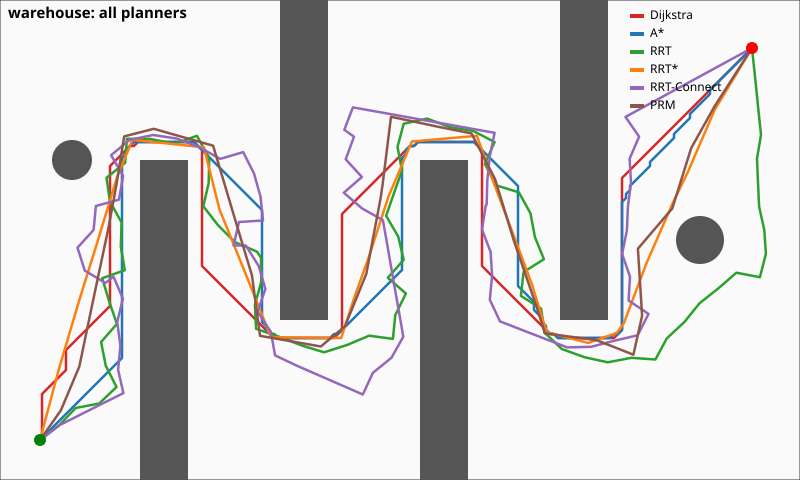
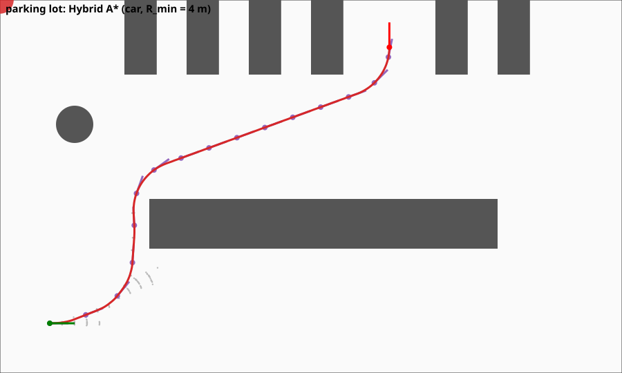
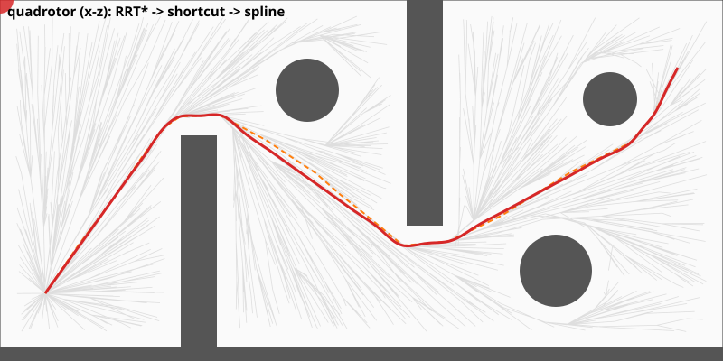

# robo-planning

Motion planning algorithms organised by **robot type and task**, in dependency-free,
deterministic Rust. Companion of [robo-control](https://github.com/rsasaki0109/robo-control),
which simulates robots tracking these plans with different controllers.

ロボットの機種・タスクごとに使い分けられる経路計画アルゴリズム集です。

| Robot / task | Module | Algorithms |
|---|---|---|
| Holonomic / differential drive on a map | `grid` | Dijkstra, A*, weighted A*, line-of-sight pruning |
| Any configuration space (point robot, arm joints, ...) | `sampling` | RRT, RRT*, RRT-Connect, PRM, shortcut smoothing |
| Car-like (minimum turning radius) | `dubins`, `hybrid_astar` | Dubins curves, Hybrid A* with Dubins analytic expansion |
| Planar serial arm | `arm` | FK, Jacobian, DLS IK, collision-aware IK, joint-space `StateSpace` |
| Differential drive, reactive | `dwa` | Dynamic Window Approach |
| All | `trajectory` | natural cubic spline, 2D arc-length spline, quintic polynomial, trapezoidal profile, curvature/accel-limited time-parameterisation, joint trajectories |
| Benchmarks | `scenes` | warehouse (AMR), parking lot (car), forest (quadrotor x-z), arm work cell |

Sampling planners are generic over the `StateSpace` trait, so adding a new robot
means implementing `sample / distance / interpolate / is_valid` once.

## Gallery

```bash
cargo run --release --example planner_gallery   # writes out/planning/*.svg + README.md
```

| | |
|---|---|
|  |  |
| Warehouse AMR: Dijkstra / A* / RRT / RRT* / RRT-Connect / PRM | Car: Hybrid A* into a parking bay |
|  |  |
| 3-link arm: collision-aware IK + joint-space RRT-Connect | Planar quadrotor: RRT* + shortcut + spline |

## Development

```bash
cargo fmt --all
cargo clippy --all-targets -- -D warnings
cargo test
```

All randomness comes from a seeded `rng::Rng`, so every planner is reproducible.

## License

MIT OR Apache-2.0
