# robo-planning

Motion planning algorithms organised by **task** and **robot type**, in deterministic
Rust with no required dependencies. Companion of
[robo-control](https://github.com/rsasaki0109/robot-control), which simulates each
robot body (wheeled, legged, humanoid, arm, drone) tracking these plans with
different controllers.

ロボットのタスク（ゴール到達・充電・掃除・巡回・追従・駐車・ピック&プレース）ごとに
使い分けられる経路計画アルゴリズム集です。

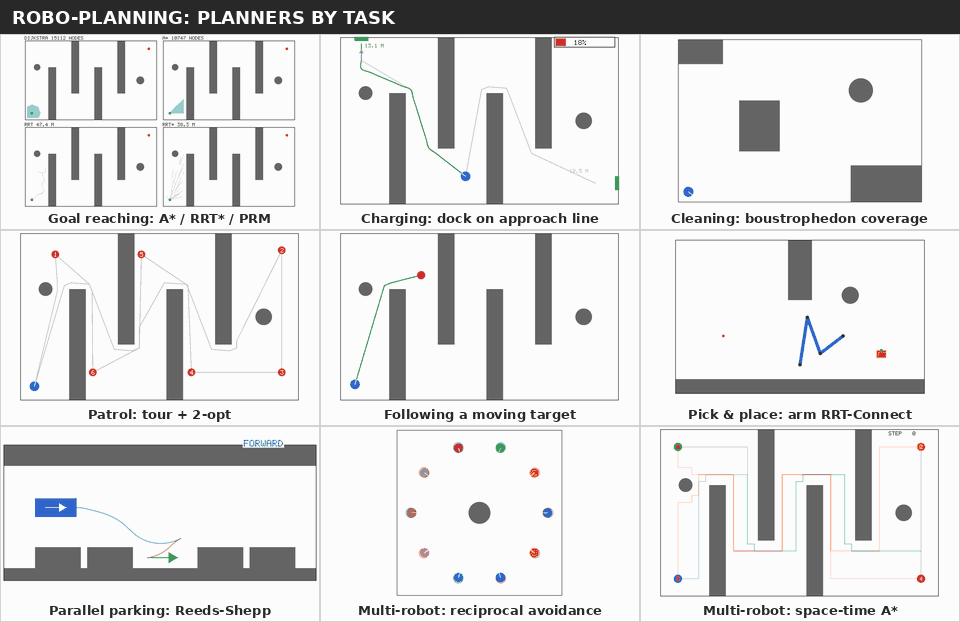

## Gallery by task

| | |
|:---:|:---:|
| 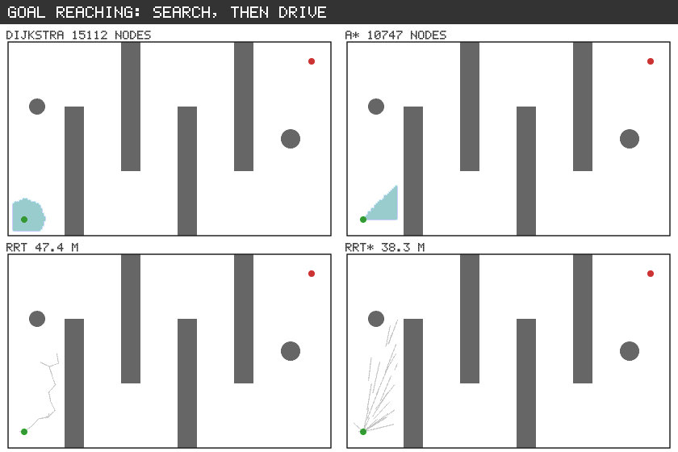 | 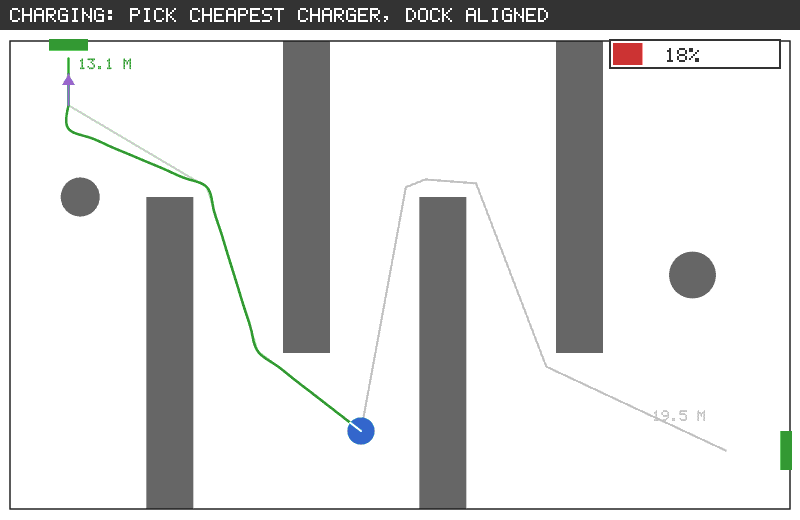 |
| **Goal reaching**: Dijkstra / A* expand cells, RRT / RRT* grow trees, then each robot drives its path | **Charging**: choose the charger with the cheapest A* path, approach the pre-dock pose, dock straight and aligned |
| 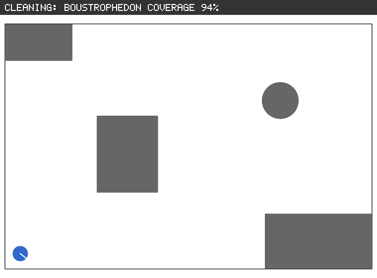 | 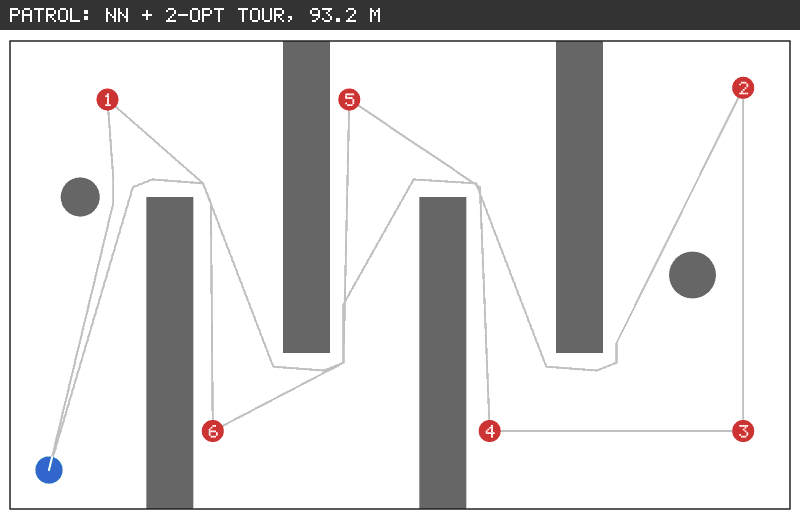 |
| **Cleaning**: boustrophedon coverage sweeps linked by A* transfers | **Patrol**: visiting order by nearest neighbour + 2-opt over A* costs |
| 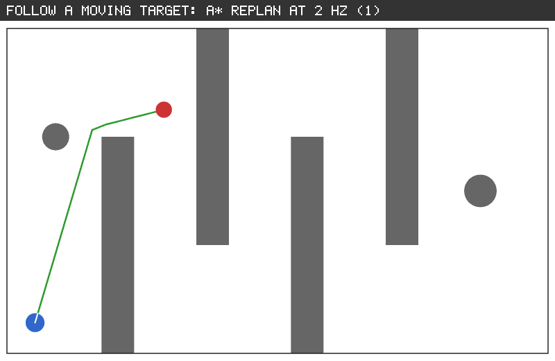 | 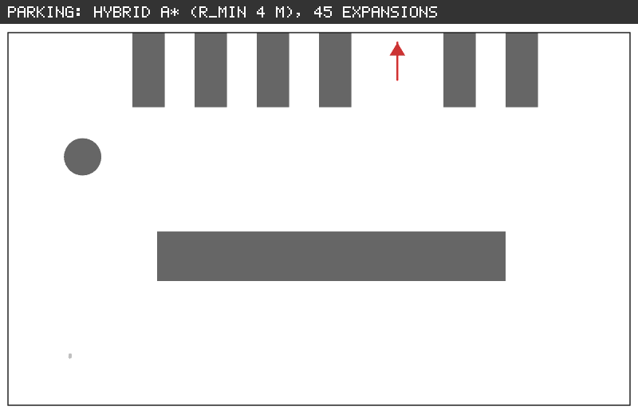 |
| **Following a moving target**: A* replanning at 2 Hz | **Parking**: Hybrid A* for a car with a 4 m turning radius |
| 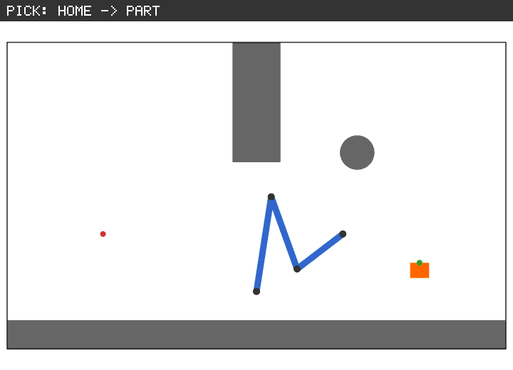 | 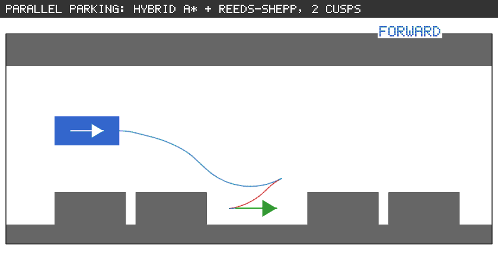 |
| **Pick and place**: collision-aware IK + joint-space RRT-Connect for a 3-link arm | **Parallel parking**: Hybrid A* with reversing and Reeds-Shepp analytic shots (red = reverse) |
| 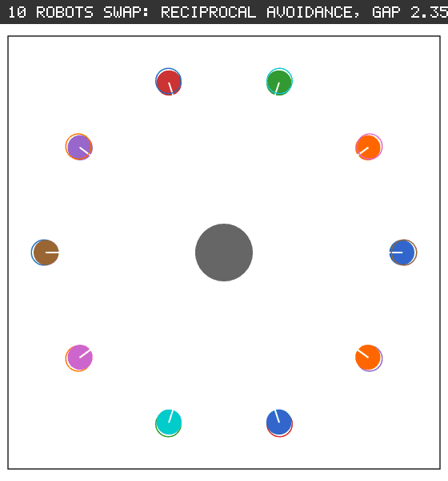 | 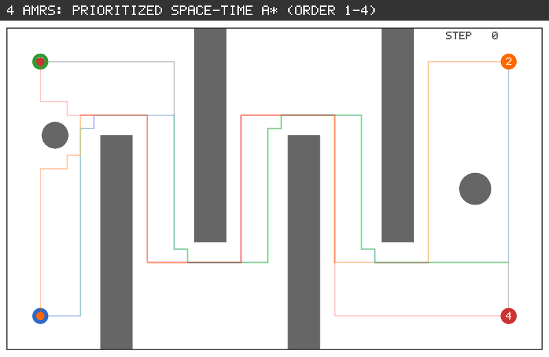 |
| **Many robots, decentralised**: 10 robots swap across a circle around an obstacle with sampled reciprocal velocity obstacles and a pass-on-the-right preference; no contact | **Many robots, centralised**: 4 AMRs cross the warehouse with prioritized space-time A* (cells and edge swaps reserved in priority order) |

```bash
cargo run --release --features render --example task_gallery            # all GIFs -> out/tasks/
cargo run --release --features render --example task_gallery parking    # just one
cargo run --release --example planner_gallery                           # SVG figures + table -> out/planning/
```

## Which planner for which task?

| Task | Robot | Module | Algorithms |
|---|---|---|---|
| Goal reaching | AMR / diff drive / holonomic | `grid` | Dijkstra, A*, weighted A*, line-of-sight pruning |
| Goal reaching in any C-space | point robot, arm joints, ... | `sampling` | RRT, RRT*, RRT-Connect, PRM, shortcut smoothing |
| Charging / docking | diff drive | `docking` | charger choice by path cost, pre-dock pose, aligned final approach |
| Cleaning / mowing / inspection | diff drive | `coverage` | boustrophedon coverage, coverage ratio |
| Patrol / delivery rounds | any mobile robot | `tour` | nearest neighbour + 2-opt over A* costs |
| Parking / on-road manoeuvres | car-like | `dubins`, `reeds_shepp`, `hybrid_astar` | Dubins curves, Reeds-Shepp curves (forward and reverse), Hybrid A* with optional reversing and Dubins / Reeds-Shepp analytic expansion |
| Fleets / crowds | many mobile robots | `multi_robot` | sampled reciprocal velocity obstacles (decentralised), prioritized space-time A* (centralised) |
| Pick and place | planar serial arm | `arm` | FK, Jacobian, DLS IK, collision-aware IK, joint-space `StateSpace` |
| Reactive local avoidance | diff drive | `dwa` | Dynamic Window Approach; `plan_with_movers` checks each rollout step against constant-velocity predictions of moving discs (people, carts) |
| Turning paths into references | all | `trajectory` | cubic / arc-length splines, quintic polynomials, trapezoidal profiles, curvature- and accel-limited time-parameterisation, joint trajectories |
| Benchmarks | all | `scenes` | warehouse (AMR), parking lot (car), forest (quadrotor x-z), arm work cell |

Sampling planners are generic over the `StateSpace` trait, so a new robot only
needs `sample / distance / interpolate / is_valid`.

| | |
|:---:|:---:|
|  | 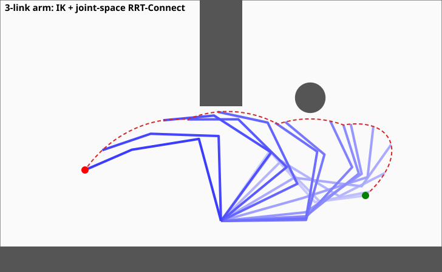 |
| All warehouse planners overlaid (`planner_gallery`) | Arm sweep along the joint-space plan |

## Features

- default: planners only, no dependencies.
- `render`: raster drawing (`tiny-skia`) and animated GIF output (`gif`) in `robo_planning::render`, also used by robo-control.

## Development

```bash
cargo fmt --all
cargo clippy --all-targets --all-features -- -D warnings
cargo test --all-features
```

All randomness comes from a seeded `rng::Rng`, so every planner and GIF is reproducible.

The hero GIF at the top tiles the gallery GIFs in `docs/media/` (needs Pillow; see the
script's docstring for the arguments):

```bash
python3 scripts/hero_gif.py docs/media/hero.gif "TITLE" docs/media/a.gif:"Caption" ...
```

## License

MIT OR Apache-2.0
